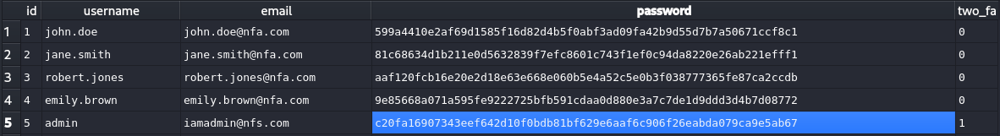
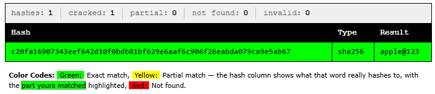
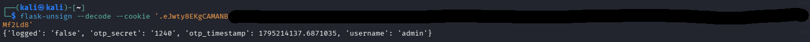
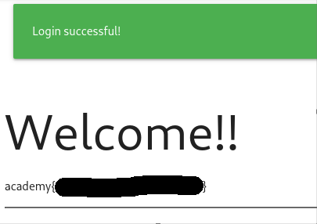

## Overview

- **Platform:** CyLab Security Academy
- **Category:** Web Exploitation
- **Difficulty:** Medium

### Description
Seems like some data has been leaked! Can you get the flag?

## Solution
### Reviewing the code
The site is a login page ("Please login to access this page"). In ``app.py``, two things stand out:
- Passwords are stored as unsalted SHA-256 hashes.
- The flag is only shown to the ``admin`` user.
  
So we need admin credentials. The leaked ``users.db`` contains the SHA-256 hash of every user's password. Hopefully it's easy to crack.

> [!INFO]- ``app.py`` code (click to see)
> ```text
> from flask import Flask, render_template, request, flash, redirect, url_for, session, send_file
> from dotenv import load_dotenv
> 
> import db
> import os
> import hashlib
> import random
> import time
> 
> load_dotenv()
> 
> app = Flask(__name__)
> app.secret_key = os.getenv('SECRET_KEY')
> 
> @app.before_request
> def initialize():
>     app.before_request_funcs[None].remove(initialize)
>     db.init_db()
> 
> @app.route("/")
> def home():
>     if 'username' not in session or session['logged'] == 'false':
>         flash('Please login to access this page', 'red')
>         return redirect(url_for('login'))
>     
>     flag = "No flag for you!!"
>     if session.get('username') == 'admin':
>         flag = os.getenv('FLAG')
>     
>     return render_template("index.html", flag=flag)
> 
> @app.route('/login', methods=['GET', 'POST'])
> def login():
>     if request.method == 'POST':
>         username = request.form['username']
>         password = request.form['password']
>         user = db.get_user_by_username(username)
>         if user and hashlib.sha256(password.encode()).hexdigest() == user['password']:
>             if user['two_fa']:
>                 # Generate OTP
>                 otp = str(random.randint(1000, 9999))
>                 session['otp_secret'] = otp
>                 session['otp_timestamp'] = time.time()
>                 session['username'] = username
>                 session['logged'] = 'false'
>                 # send OTP to mail ---
>                 return redirect(url_for('two_fa'))
>             else:
>                 session['username'] = username
>                 session['logged'] = 'true'
>                 flash('Login successful!', 'green')
>                 return redirect(url_for('home'))
>         else:
>             flash('Invalid username or password', 'red')
>     return render_template('login.html')
> 
> @app.route('/two_fa', methods=['GET', 'POST'])
> def two_fa():
>     if request.method == 'POST':
>         otp = request.form['otp']
>         stored_otp = session['otp_secret']
>         timestamp = session.get('otp_timestamp')
>         if stored_otp and otp == stored_otp and (time.time() - timestamp) < 120:
>             session['logged'] = 'true'
>             flash('Login successful!', 'green')
>             return redirect(url_for('home'))
>         else:
>             flash('Invalid OTP or OTP expired', 'red')
>             return render_template('2fa.html')
>     else:
>         return render_template('2fa.html')
> 
> @app.route('/logout')
> def logout():
>     flash('You have been logged out.', 'green')
>     session.pop('username', None)
>     session['logged'] = 'false'
>     return redirect(url_for('login'))
>```

### Cracking the admin hash
The leaked ``users.db`` contains the SHA-256 hash for the ``admin`` user. As visible below, it has 2FA activated.


I copied the admin's hash and submitted it to [CrackStation](https://crackstation.net/), which cracked it immediately as ``apple@123``. Logging in as ``admin`` with that password works, but since the account has 2FA enabled, we must bypass the OTP verification next. 


### Bypassing the OTP
From ``app.py``, we can see that the OTP is stored in the Flask session:
```text
# Generate OTP
otp = str(random.randint(1000, 9999))
session['otp_secret'] = otp
session['otp_timestamp'] = time.time()
session['username'] = username
session['logged'] = 'false'
```

Luckily, Flask sessions are only signed, not encrypted. In other words, we must simply unsign the cookie to read its contents. I copied the cookie from DevTools and decoded it with [flask-unsign](https://pypi.org/project/flask-unsign/).



As you can see above, the OTP is there in plaintext: ``1240``. After entering it on the OTP verification page, I'm successfully logged in as admin - and got the flag.
